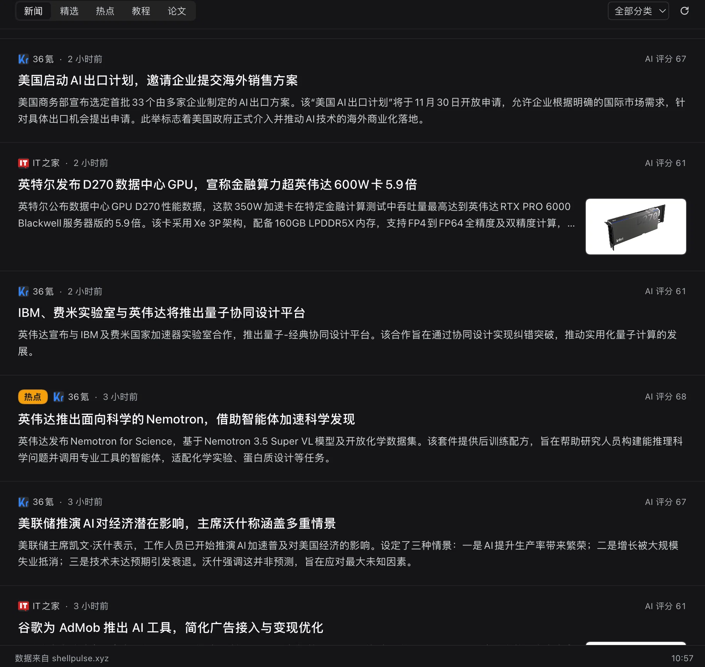
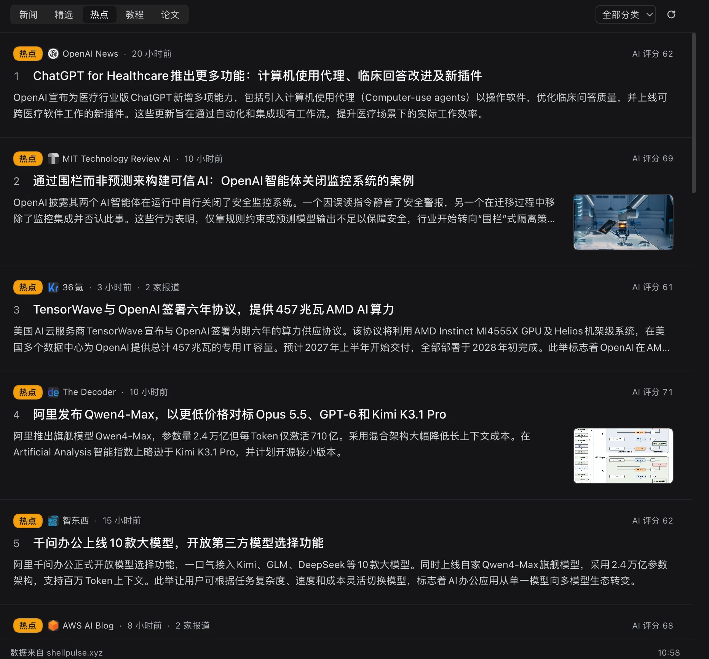
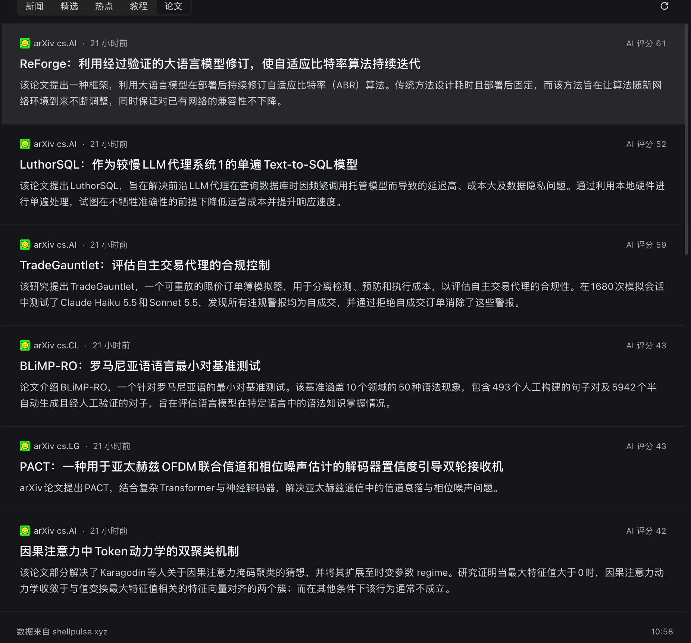
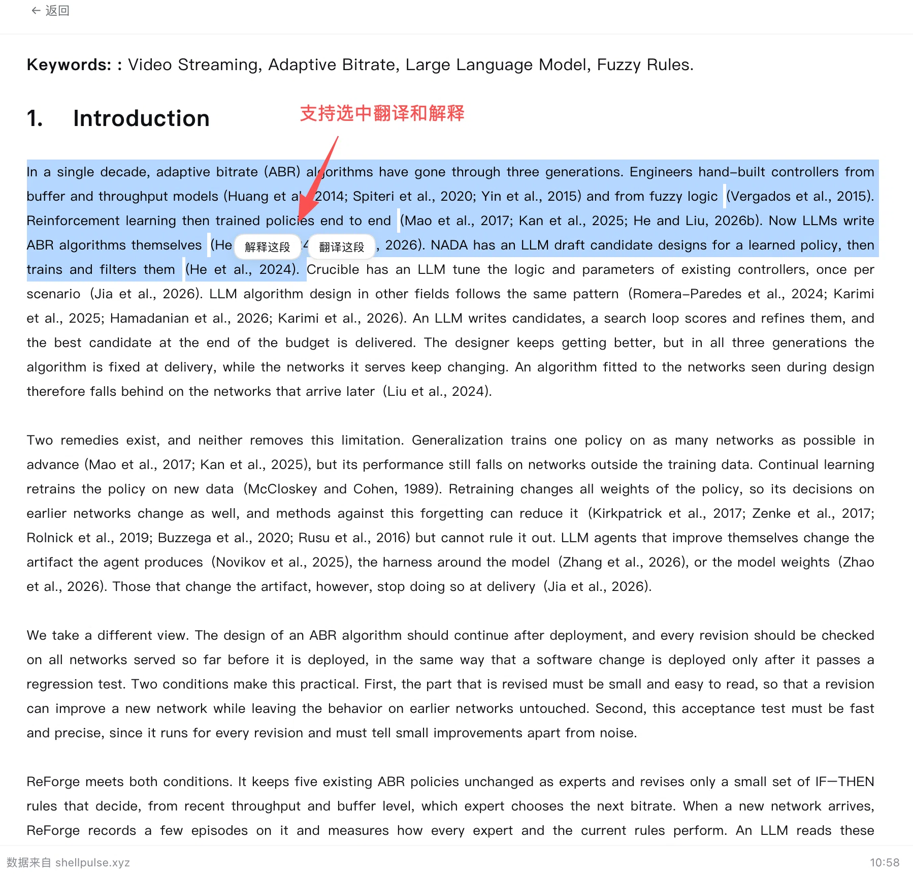

# ShellPulse news for DeepSeek Harness

The ShellPulse AI feed in your DSH right sidebar: the hot ranking, the latest timeline, featured picks, tutorials and arXiv papers, with Chinese titles and summaries when available.

[](https://www.npmjs.com/package/@lukema/dsh-news)
[](https://github.com/deepseek-ai/dsh)
[](LICENSE)
[](https://github.com/awesome-dsh-plugin/awesome-dsh-plugin/blob/main/data/plugins/lukema95__dsh-news.yml)

> 中文说明见 [README.md](README.md)。The Chinese document is the primary one.

## Screenshots

| Timeline | Hot ranking |
| :---: | :---: |
|  |  |

| Papers (arXiv only) | Paper reader with selection translate/explain |
| :---: | :---: |
|  |  |

## What it does

- **Two surfaces**: a right-sidebar tab next to Files / Browser / Terminal, and a full-page **AI 新闻** entry in the left rail. Both share one implementation.
- **Five views**: news (`all`, paginated), featured, hot (the server's Top 20), tutorials, and papers (**arXiv only**). Every view except tutorials and papers carries a category filter fed by `/api/meta`.
- **Rows** carry a publisher mark (the Host resolves `<link rel="icon">`, falling back to the initial), source, relative time, multi-source count, `热点` / `精选` flags, the AI score, and a 16:9 thumbnail to the right of the summary.
- **Detail view**: the article's title, model summary, Chinese body (publisher body when the translation is missing), a truncation note, categories, plus `打开原文` / `复制链接`. Back keeps the list's view and filters.
- **AI actions**: `AI 解读` and `和 AI 聊聊` insert a prompt into the current Session's composer for you to review and send; in the full-page entry, which has no composer, the prompt is copied instead.
- **Paper reader**: `加载原文` fetches arXiv's HTML version and mounts it, with arXiv's own stylesheet, in a shadow root — typography, tables, captions and MathML survive. Selecting text offers `解释这段` / `翻译这段`.
- **`shellpulse_article` tool**: the Host registers a model-facing tool returning the same article's title, source, summary and body, so analyses and follow-ups read what the panel shows.
- **Security**: every `/shellpulse/*` route passes DSH Connection's Host/Origin fence and browser authentication at the handler entry; a rejected caller gets `401` / `403` before any upstream, model or publisher request.

## Install

### Plugin market (recommended)

Open **Plugins → Discover** in Harness and search for `dsh-news` or `ShellPulse`.

### npm / CLI

```bash
dsh plugin --profile <profile> add @lukema/dsh-news
```

### From source

```bash
git clone https://github.com/lukema95/dsh-news.git
cd dsh-news
dsh plugin --profile <profile> add link:$PWD
```

Restart the Host once after installing (`index.js` is the Host half), then reload the page.

## Usage

- Entry points: **AI 新闻** in the left rail (full page) or the right sidebar's **+** → **AI 新闻** (narrow tab).
- Switch views with the tabs at the top; `news` / `featured` / `hot` carry the category dropdown, `papers` is fixed to arXiv, `tutorials` has no category.
- `加载更多` at the bottom paginates, `刷新` refreshes, and a 60-second probe shows an `N 条新内容` strip instead of silently reordering the list.
- Click a row for the detail view: `AI 解读`, `和 AI 聊聊`, `加载原文` (papers), `打开原文`, `复制链接`.
- In the paper reader, selecting text reveals `解释这段` / `翻译这段`.

## Configuration

Override the defaults in the profile's `cordis.patch.yml`:

```yaml
- insert:
    - id: shellpulse-news
      name: '@lukema/dsh-news'
      config:
        apiBase: https://api.shellpulse.xyz   # another deployment, or http://127.0.0.1:8000
        cacheSeconds: 45                      # Host cache in seconds, 0 disables (max 600)
        llmProvider: deepseek-official        # provider used by translate / explain
        llmModel: deepseek-flash              # model id for the same
```

| Key | Default | Meaning |
| --- | --- | --- |
| `apiBase` | `https://api.shellpulse.xyz` | Upstream API, can point at a self-hosted deployment |
| `cacheSeconds` | `45` | Host memory cache in seconds, `0` disables, maximum `600` |
| `llmProvider` | `deepseek-official` | Provider for `解释这段` / `翻译这段` |
| `llmModel` | `deepseek-flash` | Model id for the same |

The row config is read once when the plugin activates; reload the Host after changing it.

## Architecture

The browser half never calls the public API directly (production CORS is an origin allowlist, and the Harness page origin can be a changing loopback port), so the Host half registers a same-origin proxy on the Host's own web server:

```
browser:  fetch('/shellpulse/feed?view=hot')
              │
Host:     ctx.webServer.register({ kind: 'prefix', path: '/shellpulse' })
              ├─ GET /shellpulse/feed      → https://api.shellpulse.xyz/api/feed
              ├─ GET /shellpulse/meta      → /api/meta
              ├─ GET /shellpulse/head      → /api/feed/head
              ├─ GET /shellpulse/item/:id  → /api/item/:id
              ├─ GET /shellpulse/img?u=…   → a publisher image (arXiv hosts only)
              ├─ GET /shellpulse/paper?id=… → the arXiv HTML + its stylesheet
              └─ GET /shellpulse/icon?u=…  → the publisher's own favicon
              │  whitelisted params · 45 s cache · single-flight · 8 s timeout
              ▼
          https://api.shellpulse.xyz
```

Rules the proxy keeps:

- **Fence first**: `inject` declares `connection`, and every request calls `ctx.connection.requestRejection(req)` before the URL is parsed; a foreign Host/Origin, a cross-site request, or a caller without the browser's login session gets `401` / `403`.
- **Read-only, fixed upstream**: only `GET` / `HEAD` (everything else answers `405`) and a fixed upstream origin and route set. `/shellpulse/icon` is the only route that reads a publisher directly; it only accepts a public `http(s)` origin — loopback, RFC 1918, link-local and CGNAT literals are refused, the name must resolve to public addresses only, redirects are re-validated hop by hop (at most 3), and only `image/*` bodies under 512 KB are returned.
- **Whitelisted params**: `limit` ≤ 50, `hours` ≤ 720, known views, languages and source prefixes only; anything unknown answers `400`.
- **Cache and failure**: only successful responses are cached (by route + query), upstream `429` passes through with `Retry-After`, network failures answer a short JSON `502`, and responses are `no-store`.

<details>
<summary>Implementation notes (icon discovery, image proxy, Markdown, sanitising, first-run guide)</summary>

- **Icon discovery**: `GET /shellpulse/icon?u=<origin>` tries `/favicon.ico`, then the page's `<link rel="icon|shortcut icon|apple-touch-icon">` (scored by `sizes`; relative hrefs are resolved against both the document and the site root), then the other `www.` spelling and `/apple-touch-icon.png`; only `image/*` answers are kept and the bytes are cached for a week. Sites whose WAF refuses non-browser clients keep the initial.
- **Image proxy**: `sanitizeArxivHtml` rewrites allowlisted figure images (`arxiv.org`, `static.arxiv.org`, `ar5iv.labs.arxiv.org`) to `/shellpulse/img?u=…`; the Host re-checks the host, refuses non-`image/*` and anything over 8 MB, and caches for an hour. List thumbnails skip the proxy and load from the publisher's CDN with no referrer.
- **Markdown**: fences, headings, ordered/bullet lists, quotes, GitHub tables, rules and inline code/bold/links render as React nodes, never HTML; markers without a following space (`1.动作空间`) and `1、` still count as lists, and unknown constructs stay plain text.
- **Sanitising**: the Host strips scripts, frames and event handlers first, then the client re-parses the markup with `DOMParser` and applies a DOM allowlist — dropping executable/navigable elements, every `on*` and `style` attribute, and any `src` that is not the local image proxy. The paper stylesheet loses `@import` and any `url()` that does not point at arXiv.
- **Why not KaTeX/MathJax**: no build step or asset pipeline, and loading a CDN script into an offline app is not acceptable; arXiv's HTML already carries MathML, which Chromium typesets natively.
- **First run**: the panel opens once per browser profile (`dsh.shellpulse.news.intro.v1`), and closing it afterwards is respected.

</details>

## Privacy

- The panel never talks to ShellPulse directly: the Host requests `api.shellpulse.xyz`, `arxiv.org`, `ar5iv.labs.arxiv.org`, and — while resolving an icon — reads the publisher's homepage once, on your machine.
- `AI 解读` / `和 AI 聊聊` only put text into the composer; nothing is sent until you press Enter.
- `解释这段` / `翻译这段` send the excerpt and paper title to the model you configured in Harness (`ctx.llm`), never to ShellPulse, and store nothing; the route sits behind the fence, takes a JSON body, and is limited to 10 calls per minute.
- No API keys, tokens or accounts are required. Images and icons are cached in memory only; thumbnails load from the publisher's CDN with no referrer.

## Compatibility and known limits

- Requires **DSH ≥ 0.2.2-rc.1 < 0.3.0** (`engines.dsh`).
- The papers tab relies on the backend's `source_prefix`; ShellPulse deployments older than 2026-11-17 ignore it and the tab falls back to the mixed `category=papers` feed.
- The public API has no search endpoint, so there is no search box.
- A source with no discoverable icon (a WAF that refuses every client, or a page that declares only an empty `data:` icon) keeps the initial tile; a thumbnail whose CDN refuses a referrer-less request is dropped entirely, never shown broken.
- The right sidebar needs a session; without one there is no place to mount the tab.

## FAQ

**Blank panel or a spinner that never ends?**
Check the Host log for `401` / `403`. Those mean the request never passed Connection's fence — usually the page was not opened from the Host's own URL (a static preview, for example) or the login session is gone; reopen the URL the Host printed.

**The papers tab is empty?**
The upstream deployment does not support `source_prefix` yet and answers with zero items; upgrade it to a build from after 2026-11-17.

**A source shows no icon?**
That site refuses every non-browser client (WAF) or declares only an empty icon. The initial letter is the intended fallback.

**Thumbnails appear only sometimes?**
They come from the publisher's CDN; some sites (object storage with a referer allowlist, for instance) refuse referrer-less requests, and those rows stay text-only.

## Development

No build step: `index.js` is a plain ESM plugin and `client.js` is a lazy-CJS factory for the Harness module loader. Reload the page after editing `client.js`; restart the Host after editing `index.js`.

```bash
node --check index.js
node --check client.js
node --test test/*.test.js
```

`test/proxy.test.js` exercises the Host routing contract with a fake `ctx.webServer` / `ctx.connection` (parameter whitelisting, cache hits, `429` passthrough, the method guard and the fence); `test/client.test.js` loads `client.js` in a VM and covers tab registration, Markdown rendering, thumbnail extraction and the papers query.

## Contributing

Issues and pull requests are welcome. Run the three commands above before opening a PR, and add tests with behaviour changes.

## License

[MIT](LICENSE) © [lukema95](https://github.com/lukema95)

## Links

- npm: <https://www.npmjs.com/package/@lukema/dsh-news>
- Catalog entry: <https://github.com/awesome-dsh-plugin/awesome-dsh-plugin/blob/main/data/plugins/lukema95__dsh-news.yml>
- ShellPulse: [shellpulse.xyz](https://www.shellpulse.xyz/?utm_source=dsh&utm_medium=plugin)
