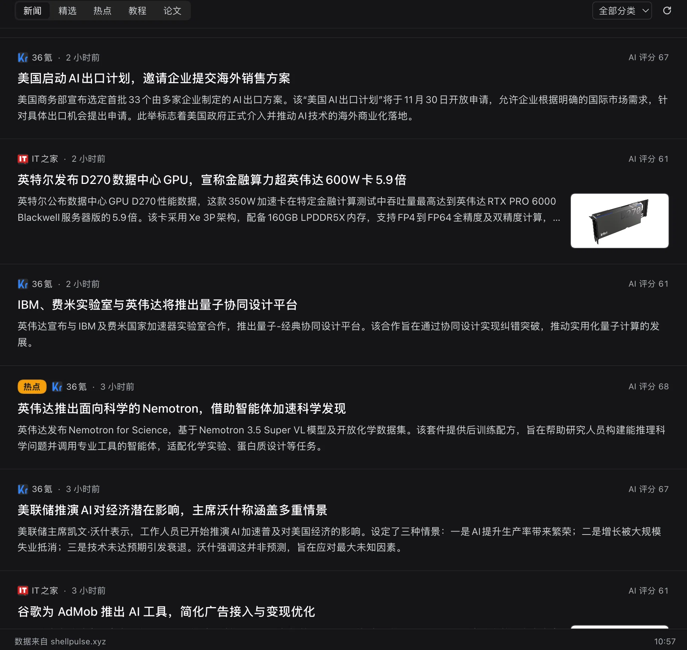
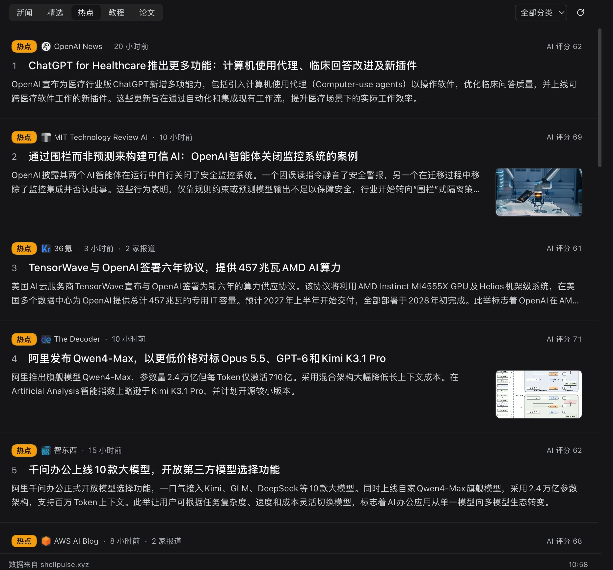
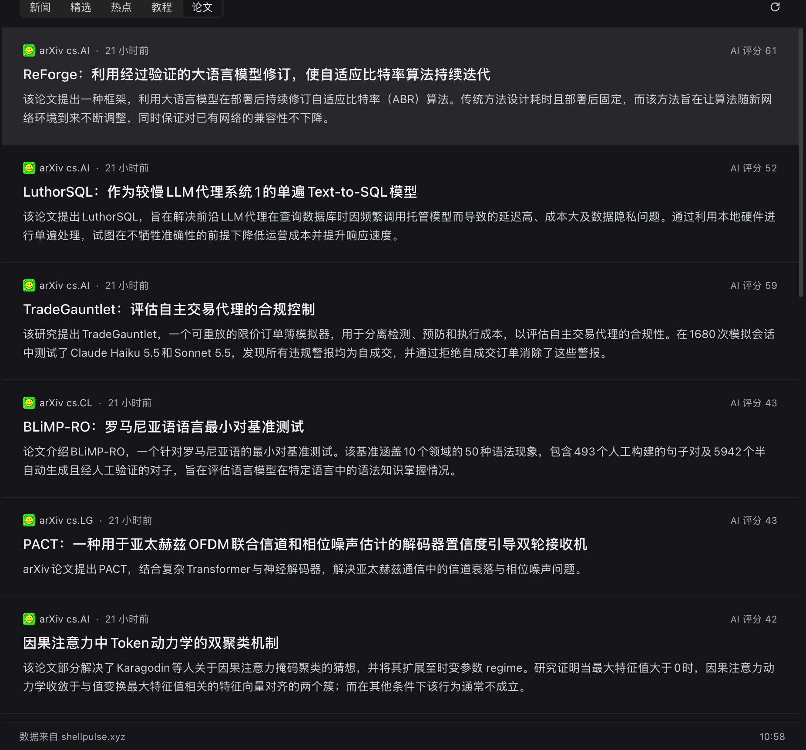
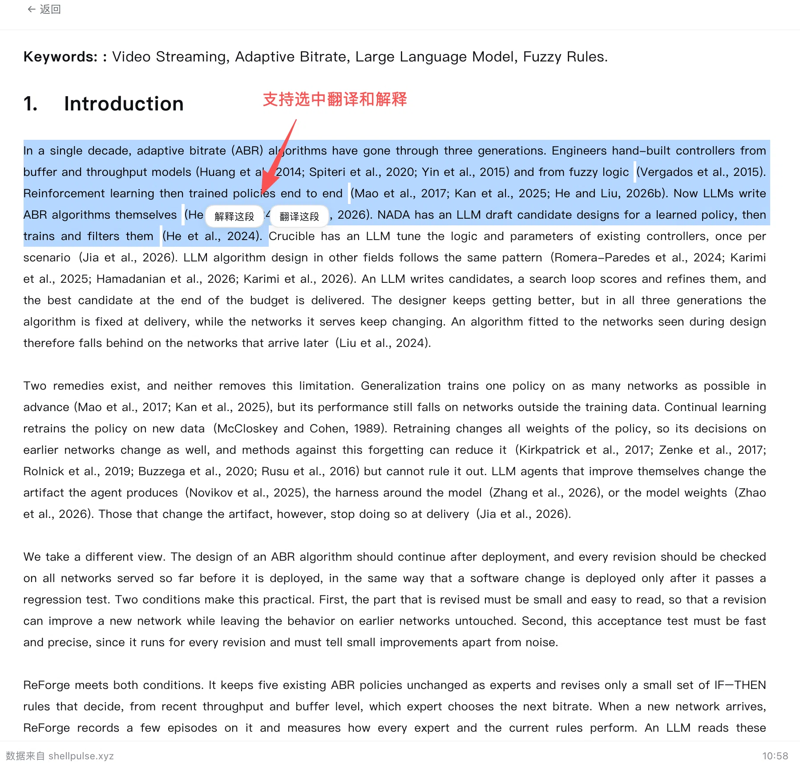

# ShellPulse 新闻 · DeepSeek Harness 插件

在 DSH 右侧栏直接刷 [ShellPulse](https://www.shellpulse.xyz/) 的 AI 信息流：热点榜、最新时间线、精选、教程和 arXiv 论文，带中文标题、中文摘要和 AI 解读。

[](https://www.npmjs.com/package/@lukema/dsh-news)
[](https://github.com/deepseek-ai/dsh)
[](LICENSE)
[](https://github.com/awesome-dsh-plugin/awesome-dsh-plugin/blob/main/data/plugins/lukema95__dsh-news.yml)

> English · [README.en.md](README.en.md)

## 截图

<table>
<tr>
<td width="50%" valign="top">
<a href="https://raw.githubusercontent.com/lukema95/dsh-news/main/assets/screenshots/news-list.webp"></a><br/>
<sub><b>新闻时间线</b> — 发布方图标、摘要缩略图、<code>热点</code> / <code>精选</code> 标签与 AI 评分。</sub>
</td>
<td width="50%" valign="top">
<a href="https://raw.githubusercontent.com/lukema95/dsh-news/main/assets/screenshots/hot-ranking.webp"></a><br/>
<sub><b>热点榜</b> — 服务端 Top 20，带名次、热点标签与多来源计数。</sub>
</td>
</tr>
<tr>
<td width="50%" valign="top">
<a href="https://raw.githubusercontent.com/lukema95/dsh-news/main/assets/screenshots/papers-arxiv.webp"></a><br/>
<sub><b>论文</b> — 只显示 arXiv 来源，可按 <code>cs.AI</code> / <code>cs.CL</code> / <code>cs.LG</code> 等分类筛选。</sub>
</td>
<td width="50%" valign="top">
<a href="https://raw.githubusercontent.com/lukema95/dsh-news/main/assets/screenshots/paper-reader.webp"></a><br/>
<sub><b>论文阅读</b> — arXiv 官方 HTML，保留论文排版，选中文字即可翻译或解释。</sub>
</td>
</tr>
</table>

## 功能

- **两个入口**：右侧栏标签页（和 Files / Browser / Terminal 并排）与左侧导航的 **AI 新闻** 整页；看新闻时对话不消失。
- **五个视图**：新闻（可加载更多）、精选、热点（服务端 Top 20）、教程、论文（**仅 arXiv**）。前三个视图可再按分类筛选。
- **列表**：发布方图标、来源、相对时间、多来源计数（N 家报道）、`热点` / `精选` 标签、AI 评分，以及摘要右侧的 16:9 缩略图。
- **详情**：点一条读全文——标题、摘要、中文正文、分类，以及 `打开原文` / `复制链接`；返回后列表的视图和筛选条件不变。
- **AI 动作**：`AI 解读`（结构化解释这篇文章）和 `和 AI 聊聊`（讨论开场白）把提示词放进当前会话输入框，由你确认后发送；整页入口没有输入框时改为复制到剪贴板。
- **论文阅读**：`加载原文` 打开 arXiv 官方 HTML 版，保留论文的排版、表格、图注和公式；选中任意段落可 `解释这段` / `翻译这段`。
- **不需要配置**：装好即用，不用 API key、token 或账号；所有请求都在你自己的机器上发出。

## 安装

### 插件市场（推荐）

在 Harness 里打开 **插件 → 发现**，搜索 `dsh-news` 或 `ShellPulse`，点安装。

### npm / 命令行

```bash
dsh plugin --profile <profile> add @lukema/dsh-news
```

### 从源码

```bash
git clone https://github.com/lukema95/dsh-news.git
cd dsh-news
dsh plugin --profile <profile> add link:$PWD
```

装好后重启一次宿主，再刷新页面。

## 使用

- 入口：左侧导航 **AI 新闻**（整页）或右侧栏 **+** → **AI 新闻**（窄标签页）。
- 顶部标签切换五个视图；`新闻` / `精选` / `热点` 带分类下拉，`论文` 固定 arXiv，`教程` 不带分类。
- 列表底部 `加载更多` 翻页，右上角 `刷新`；有新内容时出现 `N 条新内容` 横条，而不是悄悄重排列表。
- 点任意一条进入详情；详情里可用 `AI 解读`、`和 AI 聊聊`、`加载原文`（论文）、`打开原文`、`复制链接`。
- 论文视图里选中文字，浮出 `解释这段` / `翻译这段`。

## 配置

默认值开箱可用。要改（例如指向自建部署）就在 profile 的 `cordis.patch.yml` 里覆盖：

```yaml
- insert:
    - id: shellpulse-news
      name: '@lukema/dsh-news'
      config:
        apiBase: https://api.shellpulse.xyz   # 换部署地址，或 http://127.0.0.1:8000
        cacheSeconds: 45                      # 宿主缓存秒数，0 关闭（上限 600）
        llmProvider: deepseek-official        # AI 翻译/解释用的模型提供方
        llmModel: deepseek-flash              # 模型 id
```

| 键 | 默认值 | 说明 |
| --- | --- | --- |
| `apiBase` | `https://api.shellpulse.xyz` | 上游 API 地址，可指向自建部署 |
| `cacheSeconds` | `45` | 宿主内存缓存秒数，`0` 关闭，最大 `600` |
| `llmProvider` | `deepseek-official` | `解释这段` / `翻译这段` 使用的提供方 |
| `llmModel` | `deepseek-flash` | 同上，模型 id |

改完重载宿主。

## 隐私

- 面板不直连 ShellPulse：请求由你机器上的 Harness 宿主发出，只访问 `api.shellpulse.xyz`、`arxiv.org`、`ar5iv.labs.arxiv.org`，以及解析来源图标时读一次发布方首页。
- `AI 解读` / `和 AI 聊聊` 只往输入框放文本，按回车前不发送。
- `解释这段` / `翻译这段` 把选段和论文标题发到你在 Harness 里配置的模型，不经过 ShellPulse，也不落盘。
- 不需要任何账号或密钥；图片与图标只在内存里缓存，缩略图从发布方 CDN 加载时不带 referrer。

## 兼容性与已知限制

- 需要 **DSH ≥ 0.2.2-rc.1 < 0.3.0**。
- 论文标签需要 2026-11-17 之后的 ShellPulse 后端；更旧的部署会显示混合的论文流。
- 公开 API 没有搜索接口，所以面板没有搜索框。
- 少数站点不提供图标（WAF 拒绝所有客户端）或拒绝无 referrer 的缩略图，这些条目退回首字母或纯文字，不会出现破图。
- 右侧栏需要会话；没有会话时只能用整页入口。

## 许可证

[MIT](LICENSE) © [lukema95](https://github.com/lukema95)

## 相关链接

- npm：<https://www.npmjs.com/package/@lukema/dsh-news>
- 目录条目：<https://github.com/awesome-dsh-plugin/awesome-dsh-plugin/blob/main/data/plugins/lukema95__dsh-news.yml>
- ShellPulse：[shellpulse.xyz](https://www.shellpulse.xyz/?utm_source=dsh&utm_medium=plugin)
- 开发与贡献：[CONTRIBUTING.md](CONTRIBUTING.md)
